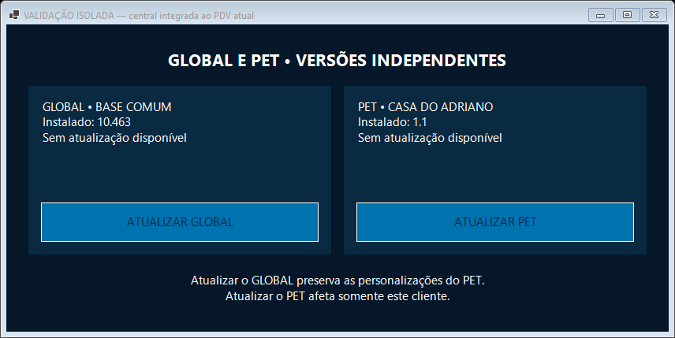

# GLOBAL/PET — perfis, migração isolada e recursos preservados

Execução aprovada: https://github.com/lealinfopdvnovo/leal-info-pdv/actions/runs/41887411602
Commit: `cd210e3df59c43dea9a4b892d8dede103033e78f`.
PR: https://github.com/lealinfopdvnovo/leal-info-pdv/pull/34

## Evidência aprovada

- PDV comum reconstruído sobre a distribuição atual GLOBAL 10.463, sem substituir pela base antiga do main.
- Todos os recursos embutidos da GLOBAL publicada, inclusive notificador nativo, preservados byte a byte. O worker independente PET é adicionado separadamente.
- 45 verificações do contrato comum, três confirmações independentes de inicialização e dez cenários do aplicador PET aprovados.
- Os quatro perfis do repositório compilados e carregados no PDV comum atual: Loja 1.2, Casa 1.1, Gelamaq 1.1 e Genilson 1.1. São versões de teste de compatibilidade, não novas versões publicadas.
- MainForm abriu nos quatro perfis; entrada Vidraçaria conferida em Loja e Casa; banco de QA permaneceu logicamente igual após carregamento e abertura.
- Bootstrap atômico testado nos quatro perfis: identidade incorreta, cápsula corrompida, pasta incompleta, interrupção antes da ativação, nova tentativa, integridade do módulo e preservação de PET já existente.
- Migração isolada com produto/estoque e movimento de caixa preenchidos: todas as linhas preservadas; backup SQLite validado e configuração conservada byte a byte.
- Worker original da Loja e PNG aprovado recuperados da distribuição real, com hashes conferidos. Recuperar o worker não equivale a executar a migração através dele.

## Capturas reais da central compilada

As imagens são do Windows descartável do teste, claramente marcadas como validação isolada. Não são imagens geradas e não comprovam instalação nos computadores dos clientes.

## O que continua impedindo publicação

Ainda não há comprovação de toda a transição pelos aplicadores antigos nem de inicialização positiva em ambiente ativado. As personalizações e recursos embutidos dos clientes precisam ser reconciliados com o PET independente, incluindo o selo: os perfis originais de compatibilidade, por si só, não comprovam essa transferência.

Nenhum feed de produção, release ou instalação de cliente foi alterado. Não declarar atualização disponível no botão ATUALIZAR. Não mesclar sobre o main antigo. A entrega completa permanece pendente desses requisitos; os testes de QA não devem ser apresentados como homologação operacional.
