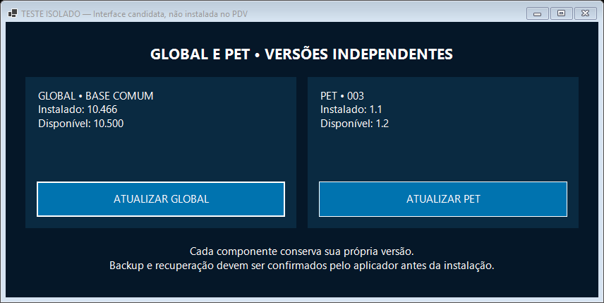

# Primeiro bloco GLOBAL/PET — candidata técnica
Autorização: execução de2em2, testes e publicação condicionada à segurança. Não solicitar nova autorização genérica.

Implementados no PR34:
- Cadastro canônico GLOBAL e PETs, com hashes de recursos reais da Loja/Gelamaq/Casa e marcação explícita de migração ainda não verificada.
- Núcleo C# com versões independentes, validação de canal/identidade, SHA256, staging isolado, recusa de ZIPs misturados, traversal, duplicatas e cancelamento.
- Feed inválido/ausente de um componente não suprime o outro.
- Interface WinForms candidata com botões independentes.

Testes:21casos aprovados Windows e Linux:
https://github.com/lealinfopdvnovo/leal-info-pdv/actions/runs/41874426273
Captura real e interface Windows aprovadas:
https://github.com/lealinfopdvnovo/leal-info-pdv/actions/runs/41874777841

A imagem é de candidata isolada, com versões fictícias de teste. Não é o PDV instalado nem prova de publicação.

Avaliação: NÃO liberar produção ainda. Falta integrar ao PDV atual, implementar/validar ativação externa e rollback independente, migração e preservação por cliente. O primeiro bloco completo ainda não está entregue; há núcleo/interface testados. Não marcar separação ou migração como concluídas.
Nenhum feed ou pacote operacional mudou nesta etapa.
