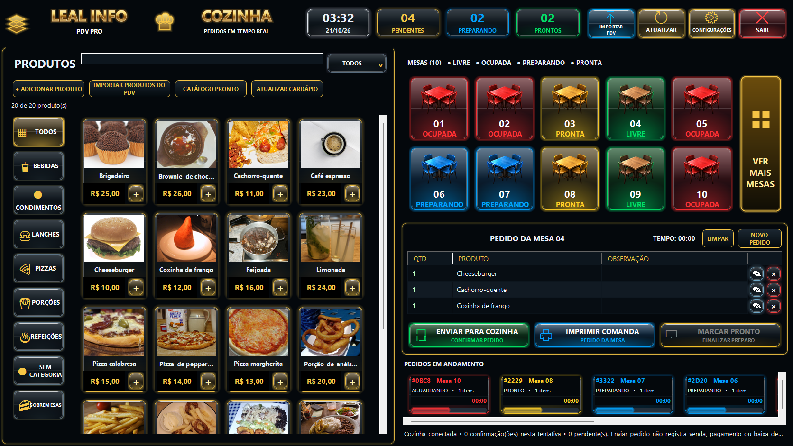

# Cozinha Premium 003 — candidata visual 10.426, NÃO PUBLICADA

Fonte validada: c6e3eb9ff4c87fa089c55078804311ee6fb88d23.
Windows: https://github.com/lealinfopdvnovo/leal-info-pdv/actions/runs/39539006348.
270 verificações e compilação aprovadas. A versão no atualizador do 003 continua 10.425. Nenhum outro cliente foi alterado.

## Acabamento implementado

Pintura WinForms com gradientes, reflexos, sombras, brilho externo, bisel e bordas iluminadas nos cartões de mesas, cabeçalho, contadores, botões operacionais e produtos. Títulos metálicos, fotos preservadas, botões + luminosos. Tabela do pedido e botões de célula explicitamente escuros. Cartões em andamento com bordas por estado e barras coloridas indicativas de estado, sem estimativa de conclusão. Correção de contraste em TODOS e proporções preservadas no modo compacto.

O seletor de categorias usa botão/menu padrão WinForms sobre o mesmo modelo de seleção/filtro existente. Cliques e seleção foram testados. A tentativa de interceptar pintura nativa foi removida após travar o encerramento do teste; a candidata final usa controles padrão sem interceptação de mensagens.

## Evidência visual

Referência inspecionada: Dashboard Futurista de Cozinha e Pedidos(5).png, 1672×941. A captura abaixo tem exatamente a mesma resolução e foi produzida pelos controles reais da aplicação em execução Windows automatizada, em base descartável de QA. Não é montagem nem imagem gerada. O arquivo é idêntico ao do artefato da execução aprovada.

A base isolada usa fotos do catálogo pronto existente e pedidos sintéticos para exercitar estados; nenhum produto foi importado no cliente. Fotos e créditos do catálogo pronto foram preservados. Não se declara reprodução idêntica pixel a pixel: fotografias dependem do cadastro, ícones e logotipo são desenhados em WinForms, e controles se adaptam à resolução. Aprovação visual do usuário ainda pendente.

## Verificações relevantes

- Capturas de pedido enviado e rascunho ativo em 1672×941; adicionalmente 1366×720 e 1920×1000.
- Ações e primeira linha do pedido visíveis; dez mesas; cronômetros sem sobreposição; filtros e clique do novo seletor; todas as janelas fechadas e descartadas ao final.
- Integração preservada: produto/pedido, quantidades e observações compartilhadas com a janela flutuante, envio, marcação de pronto e geração de páginas da comanda.
- Preços e estoque da base de teste preservados; cinco feeds conferidos sem alterações.
- Não realizados nesta etapa: impressora física, todos os DPIs em monitores físicos ou rollback do pacote 10.426. Não houve publicação automática.

SHA-256 do pacote de validação: 04877d5ad399520eea2fa1dc4cc2010a02124d4d2b057335831175d1742a4ac9.
Artefato: cozinha-layout-003-windows, execução 39539006348. PublicationAuthorized=false.
Uma futura liberação exige aprovação visual e validação do pacote exato/rollback, sem repetir testes válidos desnecessariamente.
